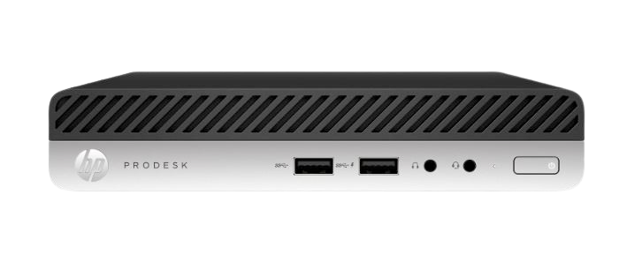

> Sorry, this is the only picture I took before rackmounting them 📸

#### About
Continuing with my theme of separation of responsibilities and 'reproducible everything' I thought a second cluster would be a good idea.

This cluster would be responsible for hosting actual workloads and services I plan on using (or offering) day-to-day.

This cluster will be ideally replacing my existing ProxMox/VM/Docker hybrid setup nightmare.

##### Overall goals:
 - Small, Redundant, Reproducible cluster
 - Low power consumption (Relatively)
 - Stackable/Rackable
 - Separate OS and Data disks
 - Should be somewhat 'cool' too

## Hardware Configuration

> HP ProDesk 400 USFF

Again I wanted something low power but powerful. In an ideal world could also run on PoE but unfortunately we're not quite there yet.

For this kind of thing, used office computers are your best bet, so onwards to ebay

I landed on some refurbished "HP ProDesk 400 G4 USFF Mini PC"s to run the workload cluster. They landed at roughly £110 per node, which seems pretty good for eighth-gen Intel silicon and NVMe storage in this footprint.

### Price Guide
> Prices are based on time of writing, 8GB Pi5, late 2024

| Model                 | CPU       | RAM  | Storage       | Cost (each) | Cluster Role |
|-----------------------|-----------|------|---------------|-------------|--------------|
| HP ProDesk 400 G4 USFF| i5-8500T  | 16 GB| 256 GB NVMe   | ~£110       | Talos worker |

They PXE boot Talos without drama, idle below 20 W, and are partially upgradable as workloads scale.

#### Alternatives Considered
I looked for a while and read up on different suggestions, some other options came close.

| Model                            | CPU       | RAM  | Storage | Typical price | Notes |
|----------------------------------|-----------|------|---------|---------------|-------|
| Dell OptiPlex 3060 Micro         | i5-8500T  | 16 GB| 500 GB  | ~£150         | Much higher per-node cost |
| Lenovo ThinkCentre M910q         | i5-7500T  | 16 GB| 256 GB  | £120–£130     | 7th gen cpu |

Those options would have worked, but the ProDesk deal struck the right balance.

### Final Shopping List
 - **HP ProDesk 400 G4 USFF** - Nodes
 - **256GB NVMe SSD** - TalOS drive
 - **SATA SSD (up to 1TB)** - Longhorn's replicated data

## Software Configuration

### OS: Talos Linux

The main cluster netboots Talos Linux volumes provided by the Pis. Nodes stay immutable and ephemeral—pull the power or reprovision hardware and Talos simply rehydrates from Git-defined state. There’s no SSH shell, and every change flows through declarative manifests.

Omni installs each machine from the same Image Factory schematic it netbooted, with the lab CA and Omni's join config baked in, so a machine still trusts the lab after the install reboots it.

### Configuration: Talos Machine Configuration

Talos supports declarative config out of the box, no need for another tool here.

### Orchestration: Kubernetes (k8s)

Talos ships a vanilla, upstream-compatible Kubernetes control plane. Once a node joins, the kubelet comes online automatically, Argo CD syncs workloads, and Longhorn attaches storage, all without manual tinkering. It’s the same Kubernetes ecosystem I use elsewhere, just delivered in a sealed, API-first package.

### Deployment: ArgoCD

Argo CD is a Git-driven deployment controller for Kubernetes that continuously applies the desired application state stored in a Git repository.

It watches manifests, Helm charts, or Kustomize configs and ensures the cluster matches them, handling updates, rollbacks, and drift detection automatically.

It's widely used for GitOps workflows where Kubernetes configuration, application releases, and operational changes are all version-controlled and applied declaratively.

### Workloads: ArgoCD Applications

> ArgoCD: How heroes ship

Each is an Argo CD Application under [`src/manifests/arda`](https://github.com/andrewiankidd/project-iluvatar/tree/main/src/manifests/arda). Anything that cannot be in this public repo (tokens, who plays) comes from the bootstrap VM's `.env`, as a Secret per app; nothing is created by hand.

#### Longhorn
[`src/manifests/arda/longhorn.yml`](https://github.com/andrewiankidd/project-iluvatar/blob/main/src/manifests/arda/longhorn.yml)
- The default storage class, three replicas across the nodes' SATA SSDs.
- Backed up nightly to a Cloudflare R2 bucket, two weeks kept. Argo CD rebuilds everything else, so volume data is all that needs backing up.

#### Minecraft
[`src/manifests/arda/minecraft.yml`](https://github.com/andrewiankidd/project-iluvatar/blob/main/src/manifests/arda/minecraft.yml)
- One folder per server, picked up by an ApplicationSet. A portal at `minecraft.kidd.network`, through the tunnel, links each server and its map.

#### Dragonwilds
[`src/manifests/arda/dragonwilds.yml`](https://github.com/andrewiankidd/project-iluvatar/blob/main/src/manifests/arda/dragonwilds.yml)
- A RuneScape: Dragonwilds dedicated server.

#### GitLab runner
[`src/manifests/arda/gitlab-runner.yml`](https://github.com/andrewiankidd/project-iluvatar/blob/main/src/manifests/arda/gitlab-runner.yml)
- A CI runner for gitlab.com, the Kubernetes executor: each job is a pod on arda, two at a time.
- It replaces a Multipass VM runner on a desktop PC. Both register with the same runner token, as two managers of one runner in GitLab, so jobs go to whichever is up and the VM can simply be switched off.
- Image builds use a privileged `docker:dind` service, as the VM did, so pipelines didn't change. arda is x86, so images build as `linux/amd64` natively.

#### Obsidian
[`src/manifests/arda/obsidian.yml`](https://github.com/andrewiankidd/project-iluvatar/blob/main/src/manifests/arda/obsidian.yml)
- A sync server for Obsidian, instead of paying for Obsidian Sync: CouchDB for the Self-hosted LiveSync plugin, at `obsidian-sync.kidd.network`. It goes through the tunnel so phones sync away from home, guarded by CouchDB's own login; turn on LiveSync's end-to-end encryption and the server only ever holds ciphertext.
- Obsidian itself in a browser (linuxserver/obsidian) at `obsidian.kidd.network`, at home or away, behind the Dex login. Its vault can sync through the same CouchDB.

#### Home Assistant
[`src/manifests/arda/homeassistant.yml`](https://github.com/andrewiankidd/project-iluvatar/blob/main/src/manifests/arda/homeassistant.yml)
- The start of replacing Nest and the Hue cloud, at `homeassistant.kidd.network`, on the LAN only. It is the container image, not Home Assistant OS, so there is no Supervisor and no add-ons: what would be an add-on (speech, an LLM, a Zigbee bridge) runs on arda as an app of its own.
- It runs on the node's own network, so its discovery hears the LAN's mDNS and SSDP: the Hue Bridge, the Google speakers and Chromecasts, and Matter devices all show up. That takes a privileged namespace under Talos's Pod Security, and it listens on the node's address as well as behind Traefik.
- `configuration.yaml` comes from Git and trusts arda's pods as proxies, so Traefik's forwarded requests are accepted. Everything made in the UI (integrations, devices, users, automations, history) stays in its Longhorn volume, which VolSync backs up.
- Its own login, not Dex: Home Assistant has no OIDC, and a login in front of it would break the companion apps, which talk to its API directly. The owner account is made on the first visit.

#### Media
[`src/manifests/arda/media.yml`](https://github.com/andrewiankidd/project-iluvatar/blob/main/src/manifests/arda/media.yml)
- Films and series, from asking to watching, on the LAN only: **Seerr** (`seerr.kidd.network`) takes requests and hands them to **Sonarr** (series) and **Radarr** (films), which search the indexers **Prowlarr** gives them, send what they pick to **qBittorrent**, and file the result into the library; **Bazarr** adds subtitles; **Jellyfin** and **Plex** play it. Seerr is Overseerr and Jellyseerr merged, so one request app serves both players.
- The Dex login guards Prowlarr, Sonarr, Radarr, Bazarr and qBittorrent, with their own logins off. Seerr, Jellyfin and Plex keep their own users, since requests and watch history belong to a person and the TV apps can't do a browser login.
- **qBittorrent only reaches the internet through Mullvad.** A gluetun sidecar in its pod holds a WireGuard tunnel and a firewall that drops everything else, so if the tunnel drops, so does qBittorrent's traffic. Only that one pod uses the VPN: the rest of arda, games and the Cloudflare tunnel included, goes out as normal. Without a Mullvad key in `.env` it doesn't start at all.
- **One volume, one layout.** Downloads and library share a single volume, mounted at `/data` in every app (`torrents/` and `media/`, after TRaSH's guides), so an import is a hardlink: instant, and no second copy. For now it's a 200 GiB Longhorn volume on arda's SSD, left out of the nightly backups (a library can be fetched again; each app's own settings are backed up). The NAS will replace it with an NFS volume of the same name, without the apps changing.
- How the apps know each other is set up for them: fixed API keys (derived from one `.env` value), Bazarr's settings written before it starts, and a CronJob that adds the rest through each app's API every 15 minutes. Indexers are deliberately left empty, to be chosen in Prowlarr.
- Transcoding is on the ProDesks' Intel GPUs (Quick Sync), through the `i915` Talos extension on the workers, so the media apps run on a worker. Some units reset themselves a couple of minutes after booting with that driver while others of the same model run it for days, so the control plane, and any worker that does that, goes without.

#### Paperless
[`src/manifests/arda/paperless.yml`](https://github.com/andrewiankidd/project-iluvatar/blob/main/src/manifests/arda/paperless.yml)
- Paperless-ngx at `paperless.kidd.network`, at home and through the tunnel: paperwork from the phone, from email and, later, from a scanner is OCR'd, tagged and searchable. The documents, database and search index live on Longhorn, so VolSync backs them up nightly to R2, encrypted by restic. That matters here: these are ID and bank documents.
- Kept small for arda's memory: SQLite rather than Postgres (one household's paperwork is well within it), a Valkey broker in the same pod, one task worker, and no Tika or Gotenberg. PDFs and images need neither; Office files and mail bodies (`.eml`) would. It uses about 600 MiB at rest.
- **Logins.** "Sign in with Dex" on the login page (Dex client `paperless`). The first Dex sign-in creates a Paperless user, and a CronJob makes it an admin within ten minutes. There is also a local superuser, `paperless`, with `ARDA_PAPERLESS_ADMIN_PASSWORD`. With Dex off the tunnel for now, the Dex button only works at home; Paperless's own login works anywhere.
- **Phone.** The Paperless Mobile (Android) and Swift Paperless (iOS) apps upload over HTTPS. Server `https://paperless.kidd.network`, at home or away. The apps can't do a Dex login, so give them a password or a token. Either use `paperless` and its password, or, as your Dex user, open *My Profile* in the web app and set a password there, or create an *API Auth Token* (Swift Paperless accepts a token).
- **Email.** Optional: set `ARDA_PAPERLESS_MAIL_HOST`, `_USER` and `_PASSWORD` (and `_PORT` or `_FOLDER` if not 993 and `INBOX`). The CronJob then creates the mail account and rule `inbox`. PDF and image attachments in that folder are consumed and the mails marked read, checked every ten minutes. Use a mailbox of its own, such as a new Gmail address with an app password, and forward paperwork to it. Without those values the rule stays off. More rules, such as other folders, senders or tags, can be added in the web app's *Mail* page, and the CronJob leaves them alone.
- **Scanner (when there is one).** Paperless's consume folder is also an SMB share, on the LAN only: `\\192.168.1.58\scan` (or `\\paperless.kidd.network\scan` at home). In the scanner's *scan to network folder* / *scan to SMB* settings: host `192.168.1.58`, share or path `scan`, user `scanner`, password `ARDA_PAPERLESS_SCANNER_PASSWORD`, domain `WORKGROUP` or blank, port 445, PDF at 300 dpi. Anything saved there is consumed within seconds and removed from the share.
- **SMB or email for a scanner?** Scan-to-email is the more dependable choice for typical home scanners and printers. Nearly all of them can do it, it works from anywhere, and it needs only the mailbox above. Scan-to-SMB is quicker and stays on the LAN, but many older or cheaper devices only speak SMB1, which this share refuses (SMB2 or newer only). If a scanner offers SMB2/3, use the share. If it offers only SMB1, use email.

#### Dex login
[`src/manifests/arda/oauth2-proxy.yml`](https://github.com/andrewiankidd/project-iluvatar/blob/main/src/manifests/arda/oauth2-proxy.yml)
- One login for all of arda's sites, with ainur's Dex as the only place users are kept. A single oauth2-proxy acts as a Traefik forward-auth Middleware; a site opts in with one Ingress annotation, `traefik.ingress.kubernetes.io/router.middlewares: oauth2-proxy-dex@kubernetescrd`.
- The login's callback is `auth.kidd.network`, and its cookie covers all of `kidd.network`, so one login does for every site.
- ainur's sites go out through arda's tunnel too, since ainur has none: annotate an ainur Ingress `kidd.network/tunnel: "true"`, as on arda, and ainur's `arda-tunnel` CronJob copies it onto arda within five minutes, forwarding its hosts to ainur. Dex, Grafana, Headlamp and Argo CD are published this way, each behind its own Dex login, so the login works from anywhere.

#### LAN HTTPS
[`traefik/values.yaml`](https://github.com/andrewiankidd/project-iluvatar/blob/main/src/manifests/arda/traefik/values.yaml)
- At home, arda's sites resolve to arda itself, not the tunnel. arda's Traefik answers them with a `*.kidd.network` certificate from the lab CA, which ainur's cert-manager makes and ainur's `arda-bootstrap` Job copies over, so a device that trusts the lab CA trusts arda's sites as it does ainur's.

#### Cloudflare
[`cloudflared.yml`](https://github.com/andrewiankidd/project-iluvatar/blob/main/src/manifests/arda/cloudflared.yml), [`external-dns.yml`](https://github.com/andrewiankidd/project-iluvatar/blob/main/src/manifests/arda/external-dns.yml), [`external-dns-tunnel.yml`](https://github.com/andrewiankidd/project-iluvatar/blob/main/src/manifests/arda/external-dns-tunnel.yml), [`ddns.yml`](https://github.com/andrewiankidd/project-iluvatar/blob/main/src/manifests/arda/ddns.yml)
- Web traffic comes in through a Cloudflare Tunnel, which publishes only the Ingresses that opt in (`kidd.network/tunnel: "true"`).
- Game ports can't use the tunnel, so their records point at the home address, which ddns keeps current, and the router forwards them.

#### Planned
Not built yet; each will follow the same pattern, storing its data on Longhorn.
- **Bitwarden**: self-hosted password manager, with shared vaults.
- **Crafty**: web-managed game server host (e.g. Minecraft), with backups and mod/pack controls.
- **A local voice assistant**: Whisper (speech to text), Piper (text to speech) and Ollama behind Home Assistant's Assist, with voice satellites where the Nest speakers are.
