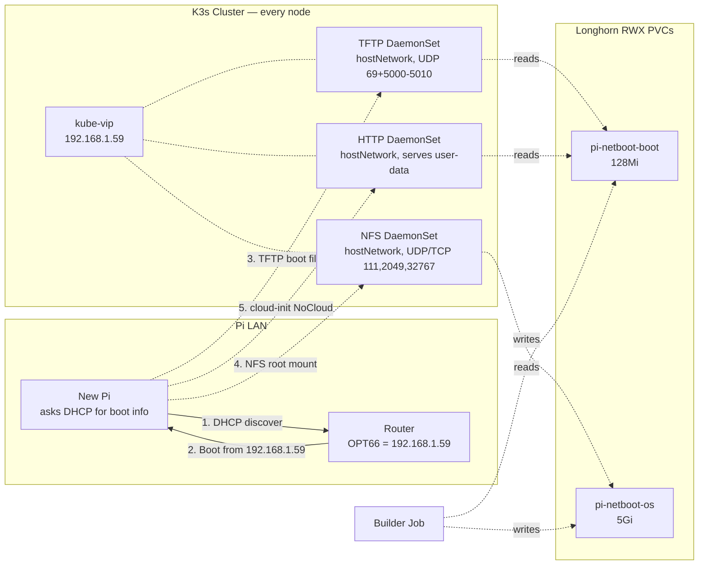

> The call is coming from inside the house.
>
> *Or, if you'd like the more dignified name for the same shape: **ouroboros** — the serpent devouring its own tail.*

The [Diskless Pi Netboot](./../Netbooting%20Raspberry%20Pi/) guide stands up a TFTP+NFS+HTTP server on a *host* machine via Docker, and the Pis boot from that. The chicken-and-egg here is annoying: that host has to exist before your cluster does, so the cluster is forever standing on top of a thing that isn't part of the cluster.

This guide is about closing that loop — moving the entire netboot stack *into* the K3s cluster the Pis boot into, so the next Pi to join the cluster gets its boot files served by the cluster it's about to join.

:::tip[Feeling lost?]
This builds directly on top of the [Ephemeral K3s Cluster](./../Ephemeral%20K3s%20Cluster/) and [Diskless Pi Netboot](./../Netbooting%20Raspberry%20Pi/) guides. If you haven't read those, the rest of this section will be hard to follow.
:::

## Explanation

The original netboot host ran four things:

- a TFTP server (Pi firmware fetches `config.txt`, `kernel.img`, etc.)
- an NFS server (Pi mounts root filesystem from this)
- an HTTP server (cloud-init `NoCloud` datasource — `user-data` / `meta-data`)
- a build pipeline that downloaded an Ubuntu image and split it into the right shape for TFTP+NFS

To replace it with cluster-native equivalents I needed:

1. **A stable single IP that Pis can be told to boot from.** Pi firmware and DHCP next-server expect one address, not a list of pods. → **kube-vip** advertises a Virtual IP at the node layer.
2. **A way to serve UDP-heavy, port-pinned protocols.** Plain Kubernetes `Service` load-balancing does not play nicely with rpcbind and TFTP's port-range expectations. → All three services run as **hostNetwork DaemonSets**.
3. **Replicated storage that any node can mount.** Boot files need to be on the same disk that's "currently serving the VIP". → **Longhorn RWX PVCs**.
4. **A way to fetch and stage the Ubuntu image declaratively.** → **A one-shot Job** that clones this repo and runs the existing build scripts against PVCs.

The result is a small but interlocking system: a VIP for stability, hostNetwork pods for protocol compatibility, RWX PVCs for storage portability, and a Job for image freshness.

## What You'll End Up With

- A single VIP (`192.168.1.59` in my case) on the LAN where Pis are told to boot from.
- TFTP, NFS, and HTTP all served from inside the cluster, with no external box involved.
- A `Job` that takes a stock Ubuntu ARM image URL, downloads it, splits boot/OS partitions into the right PVCs, and exits — re-runnable any time you want to refresh.
- A `bootstrap-http` endpoint that also re-shares the k3s leader IP and agent token across the LAN, so a Pi joining mid-flight has everything it needs.

## Components

| Piece | Where it lives | What it does |
|-------|----------------|--------------|
| [kustomization](../../../../../../src/manifests/ainur/pi-netboot/kustomization.yaml) | `src/manifests/ainur/pi-netboot/` | Composes the whole stack as one Argo CD source path. |
| [PVCs](../../../../../../src/manifests/ainur/pi-netboot/pvcs.yaml) | 6 RWX volumes | Boot, OS, NFS state, download, extracted, output. |
| [kube-vip](../../../../../../src/manifests/ainur/pi-netboot/kube-vip.yaml) | DaemonSet | Advertises the VIP on every node. |
| [Builder Job](../../../../../../src/manifests/ainur/pi-netboot/builder-job.yaml) | One-shot Job | Clones repo, runs the build pipeline, stages files into the boot/OS PVCs. |
| [TFTP DaemonSet](../../../../../../src/manifests/ainur/pi-netboot/tftp-deployment.yaml) | hostNetwork DaemonSet | Serves boot files on UDP 69 + 5000-5010. |
| [NFS DaemonSet](../../../../../../src/manifests/ainur/pi-netboot/nfs-deployment.yaml) | hostNetwork DaemonSet | Serves the root filesystem on the usual NFS3 ports. |
| [HTTP DaemonSet](../../../../../../src/manifests/ainur/pi-netboot/http-deployment.yaml) | hostNetwork DaemonSet | Serves cloud-init `user-data` plus k3s leader/agent-token files. |
| [Service](../../../../../../src/manifests/ainur/pi-netboot/http-service.yaml) + [Ingress](../../../../../../src/manifests/ainur/pi-netboot/http-ingress.yaml) | ClusterIP with `externalIPs` + Traefik | Belt-and-braces exposure of the HTTP endpoint at `bootstrap.kidd.network` and the VIP. |

## Flow at a Glance

1. **Argo CD syncs the `pi-netboot` Application** ([src/manifests/ainur/pi-netboot.yml](../../../../../../src/manifests/ainur/pi-netboot.yml)), which applies the kustomization above into the `ainur-netboot` namespace.
2. **PVCs are provisioned** by Longhorn (RWX, ext4).
3. **kube-vip pods start as a DaemonSet** and one of them claims the VIP via ARP.
4. **The builder Job runs**, sparse-clones this repo, runs `bootstrap/netboot/scripts/*` against the PVCs, and exits.
5. **TFTP, NFS, HTTP DaemonSets** come up on hostNetwork on every node, all bound to the same ports.
6. A Pi powers on with DHCP option 66 pointing at the VIP and boots through the chain.

## Caveats & "I Learned This The Spicy Way"

A few things I'm flagging upfront so you have a reasonable expectation of what's involved:

- **The TFTP and NFS containers are forks.** I'm running [andrewkidd/tftp-server](https://github.com/andrewiankidd/tftp-server) and [andrewkidd/nfs-server](https://github.com/andrewiankidd/nfs-server), both forked from upstreams that either didn't ship ARM builds or didn't expose the config knobs (port pinning, env-driven configuration) I needed for hostNetwork operation. The [NFS page](./nfs-daemonset/#about-the-container-image) has the longer story with links to the upstream issues and the PR I filed back.
- **UDP and rpcbind do not love Kubernetes.** Most of the trouble I had was teaching NFS to register on the same `rpcbind` as the VIP claims. There are init containers in [nfs-deployment.yaml](../../../../../../src/manifests/ainur/pi-netboot/nfs-deployment.yaml) that mask the host's rpcbind so the pod's can own port 111. This is privileged-pod territory and I'm not proud of it.
- **The HTTP DaemonSet has a hostPath dependency.** It mounts `/tmp/k3s/k3s-leader` and `/tmp/k3s/k3s-agent-token` from the host so a booting Pi can pull leader/agent token. These files are populated by the [k3s leader-election scripts](../Ephemeral%20K3s%20Cluster/deploying-k3s-on-netboot-nodes/) on each node. If you're following along on a non-K3s cluster or skipped that guide, the `verify-volume-mounts` initContainer will fail until you provide those files.
- **Sparse git clone happens every time the builder runs.** Builder pulls from GitHub on each Job run; if you care about airgap, swap the `git clone` in [builder-job.yaml](../../../../../../src/manifests/ainur/pi-netboot/builder-job.yaml) for a fetch from an internal mirror.

## Next Steps

Start at [Storage & PVCs](./storage-and-pvcs/) — every other page depends on understanding what's where on disk.
