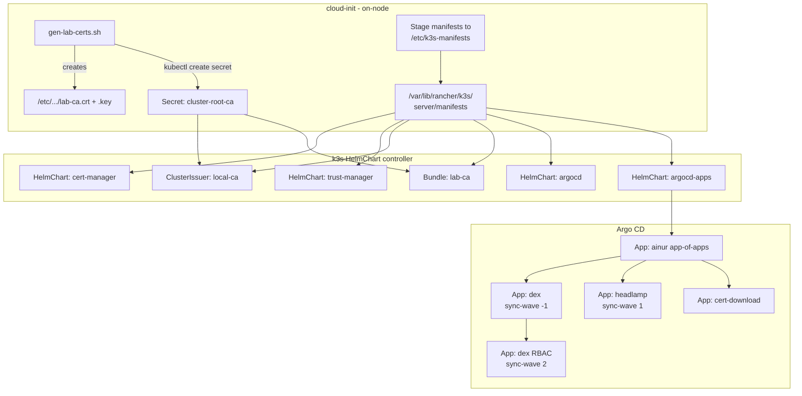

This is the bird's-eye view: how the SSO stack actually bootstraps itself from cold, in the order things happen. If you've ever wondered whether sync waves matter (they do) or what the deal is with multi-source Argo CD Applications (also a real thing), this is for you.

## Explanation

The work is split across three phases, each with a different mechanism:

1. **Cloud-init / on-node** — generates the Root CA and stages k3s HelmChart manifests onto disk. Runs once on first boot.
2. **k3s' HelmChart controller** — picks up the staged manifests under `/var/lib/rancher/k3s/server/manifests/` and reconciles them as cluster resources. Installs cert-manager, trust-manager, Argo CD itself, plus the `ClusterIssuer` and `Bundle`.
3. **Argo CD multi-source Applications** — once Argo is alive, it syncs `src/manifests/ainur/*` from this repo, deploying Dex, Headlamp, and the cert portal as Helm charts paired with in-repo Ingress/RBAC manifests.

The handoff order matters. Most reconcile loops will retry until they succeed, but a few things (Bundle's source Secret, ClusterIssuer's source Secret) will sit in a `Failed`/`NotReady` state forever if their prerequisites never appear.



## Implementation

### Phase 1: Cloud-init

The relevant pieces of [user-data](../../../../../../bootstrap/netboot/assets/ubuntuserver/boot/user-data) are:

- `write_files:` staging the CA generation script `/usr/local/sbin/gen-lab-certs.sh` (lines 232-302).
- `write_files:` staging HelmChart manifests into `/etc/k3s-manifests/` (lines 589-905) — cert-manager, trust-manager, ClusterIssuer, Bundle, Argo CD, Argo CD apps, Argo CD Ingress.
- A `tls-bootstrap.service` systemd unit (lines 304-326) that runs `gen-lab-certs.sh` after k3s is up.
- A generic `k3s-install-manifests.sh` (lines 894-905) that copies anything in `/etc/k3s-manifests/` into k3s' live manifests directory once the cluster is ready.

So everything is *declared* in user-data text and then *materialised* into Kubernetes by either systemd or k3s' HelmChart controller. Nothing here is imperative once the node is up.

### Phase 2: k3s HelmChart controller

K3s ships a built-in `helm.cattle.io/HelmChart` controller. Drop a `HelmChart` manifest into `/var/lib/rancher/k3s/server/manifests/` and the controller installs the chart for you, no Helm CLI required. The SSO stack relies on this for the things that need to exist *before* Argo CD does:

- `cert-manager` (HelmChart + CRDs).
- `trust-manager` (HelmChart).
- `local-ca` ClusterIssuer and `lab-ca` Bundle (plain manifests, applied after CRDs exist).
- `argocd` (HelmChart with the Dex OIDC config baked into values).
- `argocd-apps` (HelmChart that installs the `ainur` Application and project).
- `argocd-ingress` (plain manifest).

This is the bit that lets Argo CD bootstrap itself: by the time it's running, its OIDC config and ingress already exist.

### Phase 3: Argo CD multi-source Applications

Argo CD then takes over for everything downstream. The pattern every SSO-related Application uses is the same:

```yaml
spec:
  sources:
    - repoURL: https://charts.dexidp.io           # the upstream chart
      targetRevision: 0.19.0
      chart: dex
      helm:
        valueFiles:
          - $values/src/manifests/ainur/dex/values.yaml
    - repoURL: https://github.com/andrewiankidd/project-iluvatar.git   # in-repo sibling manifests
      targetRevision: main
      path: src/manifests/ainur/dex
    - repoURL: https://github.com/andrewiankidd/project-iluvatar.git   # the same repo registered as $values
      targetRevision: main
      ref: values
```

Three sources, one Application. The third one (`ref: values`) is the bit that surprised me when I first wrote it — without it, Argo doesn't know how to resolve `$values/...` in the first source's `valueFiles`. It's effectively saying "register this repo under the name `values` for cross-source references".

The benefit of this pattern: I get to use the upstream Helm chart unmodified, pair it with in-repo files (Ingress, RBAC) that get applied to the same destination namespace, *and* keep `values.yaml` versioned in git. No Kustomize, no Helmfile, no custom chart wrapper.

### Sync waves

Two of the SSO Applications have explicit `argocd.argoproj.io/sync-wave` annotations:

| Resource | Wave |
|----------|------|
| [`dex` Application](../../../../../../src/manifests/ainur/dex.yml) | `-1` |
| [`headlamp` Application](../../../../../../src/manifests/ainur/headlamp.yml) | `1` |
| [`oidc-admin-admin-at-kidd-network` ClusterRoleBinding](../../../../../../src/manifests/ainur/dex/rbac-admin-user.yml) | `2` |
| [`pi-netboot` Application](../../../../../../src/manifests/ainur/pi-netboot.yml) | `0` (default) |

Lower numbers sync earlier. Dex syncs first so the OIDC issuer exists by the time Headlamp tries to find it. The ClusterRoleBinding syncs *last* because applying a binding for a user that doesn't exist yet is fine (it lands as soon as a Dex login mints that user identity), but I wanted to keep the namespace and Dex installation cleanly separated from the cluster-level RBAC change.

### `managedNamespaceMetadata` — the trust loop

Every SSO Argo CD Application has the same little syncPolicy fragment:

```yaml
syncPolicy:
  managedNamespaceMetadata:
    labels:
      ainur.kidd.network/ca: inject
  syncOptions:
    - CreateNamespace=true
```

This is the bit that closes the loop and saves anyone from running `kubectl label namespace …`. Argo CD writes the label on every sync; trust-manager sees the label and publishes the `lab-ca` ConfigMap; the pod mounts the ConfigMap; outbound TLS verifies.

Full chain in one breath: Argo Application sync → namespace label → trust-manager Bundle reconcile → `lab-ca` ConfigMap in namespace → pod volume mount → `SSL_CERT_DIR` points at it → curl works.

### CA download portal

Slightly off to the side, but worth mentioning: [src/manifests/ainur/cert/](../../../../../../src/manifests/ainur/cert) deploys an NGINX serving a single styled HTML page plus the CA certificate file, fronted by Traefik at `cert.kidd.network`. The page itself ([cert/site.yml](../../../../../../src/manifests/ainur/cert/site.yml)) has install instructions for macOS / Windows / Linux. trust-manager publishes the CA into `ainur-cert` namespace (same label trick), and the NGINX deployment mounts that ConfigMap into `/usr/share/nginx/html/ca` for the `/ca.crt` download endpoint.

There's a small bit of cleverness in the [nginx-conf.yml](../../../../../../src/manifests/ainur/cert/nginx-conf.yml): the `/ca.crt` location adds a `Content-Disposition: attachment` header so the browser downloads it instead of trying to render it.

## What "running" looks like

If everything's converged, you should see:

```text
$ kubectl get application -A
NAMESPACE   NAME             SYNC STATUS   HEALTH STATUS
argocd      ainur            Synced        Healthy
argocd      system-addons    Synced        Healthy
ainur       dex              Synced        Healthy
ainur       headlamp         Synced        Healthy
ainur       cert-download    Synced        Healthy
ainur       pi-netboot       Synced        Healthy
ainur       longhorn         Synced        Healthy
ainur       sidero-omni      …

$ kubectl get clusterissuer local-ca && kubectl get bundle lab-ca
NAME       READY   AGE
local-ca   True    1d
NAME     CONFIGMAP TARGET   SYNCED
lab-ca   ca.crt              True
```

## Next Steps

The honest [Next Steps](./next-steps/) — what's still imperfect and where this all goes next.
