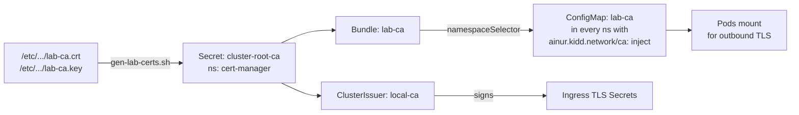

This is the load-bearing piece. Once cert-manager has the Root CA as a Secret and trust-manager has a `Bundle` pointing at it, you can hand out TLS certs and trusted-root ConfigMaps to anything in the cluster more or less for free.

## Explanation

There are four things going on, and it's easy to mix them up:

1. **The CA material.** A private key and a self-signed cert that says "this key is allowed to issue certs in this lab". Generated once on the node, stored in `/etc/rancher/k3s/oidc/lab-ca.crt` and `/etc/k3s-certs/lab-ca.key`.
2. **The CA-as-Secret.** Kubernetes only knows about Secrets, not files. `gen-lab-certs.sh` packs both files into a `kubernetes.io/tls` Secret named `cluster-root-ca` in the `cert-manager` namespace.
3. **The `ClusterIssuer`.** A cluster-scoped issuer that tells cert-manager "when somebody asks for a cert, sign it with the key in that Secret".
4. **The `Bundle`.** A trust-manager resource that takes the *public* half of the CA out of the Secret and publishes it as a ConfigMap named `lab-ca` into every namespace that wears the label `ainur.kidd.network/ca: inject`.

Once those four are in place, everything else is just consumption. An `Ingress` annotated with `cert-manager.io/cluster-issuer: local-ca` gets HTTPS. A `Pod` that mounts the `lab-ca` ConfigMap can trust outbound TLS to other cluster apps.



## Implementation

### CA generation (automatic, runs on the node at boot)

cert-manager could happily generate its own self-signed root inside the cluster, but I wanted the *same* CA usable as the OIDC CA for the k3s API server too — and the API server reads it via `--oidc-ca-file=/etc/rancher/k3s/oidc/lab-ca.crt`, which means it has to exist as a plain file on disk *before* k3s starts. That can't come from a Kubernetes resource because there's no Kubernetes yet.

So `gen-lab-certs.sh` is staged onto each node by cloud-init ([user-data:232-302](../../../../../../bootstrap/netboot/assets/ubuntuserver/boot/user-data)) and run automatically by the `tls-bootstrap.service` systemd unit ([user-data:304-326](../../../../../../bootstrap/netboot/assets/ubuntuserver/boot/user-data)). You don't touch it; it just runs.

```bash
# /usr/local/sbin/gen-lab-certs.sh (excerpt — bootstrap/netboot/assets/ubuntuserver/boot/user-data:248-255)
CA_CRT=/etc/rancher/k3s/oidc/lab-ca.crt
CA_KEY=/etc/k3s-certs/lab-ca.key
if [ ! -s "$CA_CRT" ] || [ ! -s "$CA_KEY" ]; then
  umask 077
  openssl genrsa -out "$CA_KEY" 4096
  openssl req -x509 -new -nodes -key "$CA_KEY" -sha256 -days 3650 \
    -subj "/CN=Lab Root CA" -addext "basicConstraints=critical,CA:true" -out "$CA_CRT"
fi
```

The `if [ ! -s ... ]` guard makes this idempotent — if the files exist, leave them alone. That matters because the script runs every boot. If you ever need to rotate, delete both files on the node and let the next boot recreate them. (Everything that trusted the old CA will need to retrust the new one.)

### Importing the CA as a Secret

```bash
# /usr/local/sbin/gen-lab-certs.sh (excerpt)
kubectl -n cert-manager create secret tls cluster-root-ca \
  --cert="$CA_CRT" --key="$CA_KEY" -o yaml --dry-run=client | kubectl apply -f -
```

The `--dry-run=client | apply -f -` pattern is the idiomatic "upsert a Secret from files" trick. Plain `create secret` would error if the Secret already exists; this version just reconciles it.

### ClusterIssuer

Staged to k3s' manifests dir from cloud-init, so it's applied as soon as cert-manager's CRDs are ready:

```yaml
# /etc/k3s-manifests/03-clusterissuer-local-ca.yaml
# bootstrap/netboot/assets/ubuntuserver/boot/user-data:629-640
apiVersion: cert-manager.io/v1
kind: ClusterIssuer
metadata:
  name: local-ca
spec:
  ca:
    # Secret is created at runtime by gen-lab-certs.sh
    secretName: cluster-root-ca
```

Nothing surprising — a CA-type issuer that points at the Secret we just upserted. Any cert-manager Certificate (or Ingress annotated with `cert-manager.io/cluster-issuer: local-ca`) will be signed by this.

### trust-manager Bundle

This is the bit that took me longest to internalise. cert-manager issues certs *signed* by the CA, but it doesn't *distribute* the CA's public cert to the things that need to verify those signatures. That's trust-manager's job.

```yaml
# /etc/k3s-manifests/05-trust-bundle-namespaced.yaml
# bootstrap/netboot/assets/ubuntuserver/boot/user-data:642-663
apiVersion: trust.cert-manager.io/v1alpha1
kind: Bundle
metadata:
  # Name this Bundle to match the desired ConfigMap name in target namespaces.
  # Some trust-manager versions default the ConfigMap name to the Bundle name.
  name: lab-ca
spec:
  sources:
    - secret:
        name: cluster-root-ca
        key: tls.crt
        namespace: cert-manager
  target:
    configMap:
      key: ca.crt
    namespaceSelector:
      matchLabels:
        ainur.kidd.network/ca: "inject"
```

The whole thing reads as: "pull `tls.crt` out of the `cluster-root-ca` Secret in `cert-manager`, and write it as `ca.crt` inside a ConfigMap called `lab-ca` in every namespace labelled `ainur.kidd.network/ca: inject`."

So far so simple, but the next page is where the GitOps trick that makes this *automatic* lives.

### How namespaces get labelled

You're probably expecting a `kubectl label namespace …` somewhere. There isn't one. Each Argo CD Application uses `syncPolicy.managedNamespaceMetadata` to write the label onto its destination namespace on every sync. See [Managing certificates with volume mounts](./managing-certificates-with-volume-mounts/) for the chain.

## What you should see after this lands

```text
$ kubectl get clusterissuer local-ca
NAME       READY   AGE
local-ca   True    1d

$ kubectl get bundle lab-ca
NAME     CONFIGMAP TARGET   SYNCED
lab-ca   ca.crt              True

$ kubectl get configmap -A -l '!ainur.kidd.network/ca' | head
# (empty — labels are on the namespace, not on the CM)

$ kubectl get cm lab-ca -A
NAMESPACE         NAME     DATA   AGE
ainur-cert        lab-ca   1      1d
ainur-dex         lab-ca   1      1d
ainur-headlamp    lab-ca   1      1d
ainur-netboot     lab-ca   1      1d
```

If the `Bundle` says `Synced: True` but you don't see the ConfigMaps in your target namespaces, jump to [Troubleshooting](./troubleshooting-common-issues/#trust-bundle-not-landing-in-a-namespace) — it's almost always a label issue.

## Next Steps

The CA is now usable. The next step is [Setting Up Dex for OIDC](./setting-up-dex-for-oidc/), which is the first app that consumes the issuer for its own Ingress cert.
