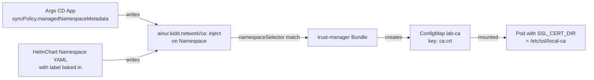

This page is mostly about the bit that I find genuinely clever: the `lab-ca` ConfigMap ends up in every namespace that needs it without anyone ever running `kubectl label namespace`. There are three pieces co-operating, and once you see the chain it's hard to un-see.

## Explanation

trust-manager's `Bundle` ([covered earlier](./configuring-cert-manager-self-signed-ca/#trust-manager-bundle)) has this selector:

```yaml
target:
  configMap:
    key: ca.crt
  namespaceSelector:
    matchLabels:
      ainur.kidd.network/ca: "inject"
```

So a namespace gets the `lab-ca` ConfigMap **iff** it wears the label `ainur.kidd.network/ca: inject`. Nothing surprising there.

The clever part is *how* the label gets applied. Three different mechanisms are in play, depending on how the namespace itself came into existence:

| Namespace | How the label arrives |
|-----------|------------------------|
| `ainur-dex`, `ainur-headlamp`, `ainur-cert`, `ainur-netboot` | Argo CD writes it via `syncPolicy.managedNamespaceMetadata` on each `Application` |
| `argocd` | The HelmChart that installs Argo CD includes a `Namespace` resource with the label baked in |
| `cert-manager` | trust-manager itself runs there but doesn't need the bundle — it has the Secret directly |

None of those require a human action. The label appears, trust-manager notices, the ConfigMap shows up, and the pods that mount it gain trust of the lab CA.



## Implementation

### Option 1: managedNamespaceMetadata (Argo CD apps)

This is what Dex, Headlamp, and the cert portal use:

```yaml
# src/manifests/ainur/dex.yml (excerpt) — and identically in headlamp.yml, cert.yml
syncPolicy:
  managedNamespaceMetadata:
    labels:
      ainur.kidd.network/ca: inject
  syncOptions:
    - CreateNamespace=true
```

`managedNamespaceMetadata` is an Argo CD `syncPolicy` field that tells Argo "on every sync, ensure the destination namespace exists *and* carries these labels (and annotations)". Combined with `CreateNamespace=true` it means Argo creates the namespace if it's missing, and labels it correctly every time, idempotently. If somebody runs `kubectl label namespace ainur-dex ainur.kidd.network/ca-` to remove the label, the next Argo CD sync puts it back.

### Option 2: Inline label on the Namespace resource

Used for the `argocd` namespace, where Argo CD isn't the deployer:

```yaml
# bootstrap/netboot/assets/ubuntuserver/boot/user-data:691-696
apiVersion: v1
kind: Namespace
metadata:
  name: argocd
  labels:
    ainur.kidd.network/ca: inject
```

This `Namespace` is part of the same HelmChart manifest that installs Argo CD via k3s' HelmChart controller. Argo CD itself never manages this namespace — it lives in it — so we just label it directly.

### Mounting `lab-ca` into a pod

Once the ConfigMap is in the namespace, apps mount it the same way regardless of how the namespace got labelled:

```yaml
env:
  - name: SSL_CERT_DIR
    value: /etc/ssl/local-ca
volumes:
  - name: lab-ca
    configMap:
      name: lab-ca
      optional: true
volumeMounts:
  - name: lab-ca
    mountPath: /etc/ssl/local-ca
    readOnly: true
```

This block (or a very close variant) shows up in [headlamp/values.yaml:18-29](../../../../../../src/manifests/ainur/headlamp/values.yaml), the Argo CD server and repo-server values inside [user-data:723-752](../../../../../../bootstrap/netboot/assets/ubuntuserver/boot/user-data), and the cert portal's deployment.

The two important bits:

- **`SSL_CERT_DIR`** is an OpenSSL convention. Tell most TLS-capable processes "look here for trusted root certs" and they will. Headlamp, Argo CD's Go binaries, curl, openssl — they all respect it. It's a much lighter-touch fix than `update-ca-certificates` inside a container.
- **`optional: true`** is a safety net. If you ever deploy an app *before* trust-manager has reconciled the ConfigMap into the namespace, the volume mount won't fail and crashloop the pod. The pod just runs with an empty `/etc/ssl/local-ca` until trust-manager catches up, at which point the mount becomes populated (the kubelet refreshes mounted ConfigMaps).

## What you should see after this lands

```text
$ kubectl get cm lab-ca -A
NAMESPACE         NAME     DATA   AGE
ainur-cert        lab-ca   1      1d
ainur-dex         lab-ca   1      1d
ainur-headlamp    lab-ca   1      1d
ainur-netboot     lab-ca   1      1d
argocd            lab-ca   1      1d

$ kubectl -n ainur-headlamp exec deploy/headlamp -- ls /etc/ssl/local-ca
ca.crt

$ kubectl -n ainur-headlamp exec deploy/headlamp -- sh -c 'curl -s --cacert /etc/ssl/local-ca/ca.crt https://dex.kidd.network/.well-known/openid-configuration | head -c 60'
{"issuer":"https://dex.kidd.network","authorization_endpoint
```

If `kubectl get cm lab-ca -n <namespace>` comes up empty, the [Troubleshooting](./troubleshooting-common-issues/#trust-bundle-not-landing-in-a-namespace) page has the usual suspects.

## Next Steps

[Verifying OIDC Authentication](./verifying-oidc-authentication/) walks through what a fully wired-up login flow looks like end-to-end, so you can be sure the CA and OIDC layers are co-operating.
