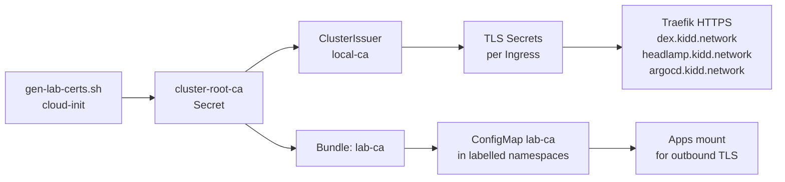

By this point I had an [ephemeral K3s cluster](./../Ephemeral%20K3s%20Cluster/) booting itself from scratch, Argo CD syncing apps from this repo, and Headlamp staring at me asking for a login. The obvious next move was a sane login story: one identity, end-to-end TLS, no plaintext anywhere, and no fragile copy-pasting of passwords from `~/.bashrc`.

:::tip[Feeling lost?]
This guide assumes you already have a cluster up the way I built it. If not, start with [Ephemeral K3s Cluster](./../Ephemeral%20K3s%20Cluster/) and come back here once Argo CD is happy.
:::

## Explanation

I had three things I wanted to fix at once:

1. **One login for every UI.** Headlamp, Argo CD, and (eventually) other things should all defer to the same identity store. I didn't want a per-app password file.
2. **HTTPS everywhere, including internal hosts.** Browser-trusted certs without paying for or proving out a public domain. The cluster is private, so a private Certificate Authority is fine.
3. **Stay GitOps-pure.** No `kubectl create secret …` at a terminal. Everything reconcilable from this repo, including the bits that bootstrap the rest.

The shape that fell out of this:

- **Dex** as the OIDC provider. Tiny, declarative, perfect for a lab.
- **A self-signed Root CA** that lives on the node and gets handed to cert-manager.
- **cert-manager** with a `ClusterIssuer` backed by that CA, issuing TLS for every internal hostname.
- **trust-manager** to publish the CA into a `lab-ca` ConfigMap that any app can mount to trust outbound TLS calls.
- **Traefik** doing the Ingress part; cert-manager auto-issues the TLS secret it serves.

It's surprising how few moving parts that ends up being once you let Argo CD do the wiring.

## What You'll End Up With

- [`https://dex.kidd.network`](https://dex.kidd.network) — OIDC provider, trusted by your browser.
- [`https://headlamp.kidd.network`](https://headlamp.kidd.network) — Kubernetes dashboard with "Login with Dex" working.
- [`https://argocd.kidd.network`](https://argocd.kidd.network) — Argo CD UI authed by the same Dex identity.
- [`https://cert.kidd.network`](https://cert.kidd.network) — a tiny download page to trust the CA on any new machine.
- `kubectl` can authenticate against the k3s API via the same OIDC issuer (optional but free once Dex is up).

## Components

| Piece | Where it lives | What it does |
|-------|----------------|--------------|
| Dex | [src/manifests/ainur/dex.yml](../../../../../../src/manifests/ainur/dex.yml), [dex/values.yaml](../../../../../../src/manifests/ainur/dex/values.yaml) | OIDC provider; static clients for Headlamp and Argo CD |
| cert-manager + trust-manager | Installed via [user-data:589-627](../../../../../../bootstrap/netboot/assets/ubuntuserver/boot/user-data) HelmCharts | Issue TLS, distribute CA to namespaces |
| Root CA | Generated by `gen-lab-certs.sh` ([user-data:232-302](../../../../../../bootstrap/netboot/assets/ubuntuserver/boot/user-data)) | Lives at `/etc/rancher/k3s/oidc/lab-ca.crt`; imported as `cluster-root-ca` Secret |
| `lab-ca` Bundle | [user-data:642-663](../../../../../../bootstrap/netboot/assets/ubuntuserver/boot/user-data) | trust-manager Bundle that targets namespaces labelled `ainur.kidd.network/ca: inject` |
| Headlamp OIDC client | [src/manifests/ainur/headlamp/values.yaml](../../../../../../src/manifests/ainur/headlamp/values.yaml) | Mounts `lab-ca` so it trusts Dex's cert |
| Argo CD OIDC config | Embedded in [user-data](../../../../../../bootstrap/netboot/assets/ubuntuserver/boot/user-data) at the Argo CD HelmChart block | Wires Argo CD to Dex; lives in user-data because Argo bootstraps the rest of GitOps |
| CA download portal | [src/manifests/ainur/cert/](../../../../../../src/manifests/ainur/cert) | Friendly page at `cert.kidd.network` with install instructions per OS |

## Flow at a Glance

1. The node boots and `gen-lab-certs.sh` generates the Root CA (if it doesn't already exist) and stores it on disk.
2. cert-manager and trust-manager are installed via k3s HelmChart manifests staged from cloud-init.
3. `cluster-root-ca` Secret is created in the `cert-manager` namespace from the on-disk CA.
4. `ClusterIssuer local-ca` and the `lab-ca` `Bundle` are applied.
5. Argo CD syncs the `dex`, `headlamp`, and `cert-download` applications.
6. Each Argo CD `Application` uses `syncPolicy.managedNamespaceMetadata` to drop the `ainur.kidd.network/ca: inject` label onto its destination namespace.
7. trust-manager sees the label and publishes the `lab-ca` ConfigMap into the namespace.
8. cert-manager issues TLS for each Ingress; Traefik serves the apps over HTTPS.
9. You trust the CA on your laptop once (via [cert.kidd.network](https://cert.kidd.network)) and you're done.

## Next Steps

Walk through the [prerequisites](./prerequisites/) to make sure the cluster you have lines up with the cluster I'm assuming, then start at [Configuring cert-manager for a Self-Signed CA](./configuring-cert-manager-self-signed-ca/) and work down.
